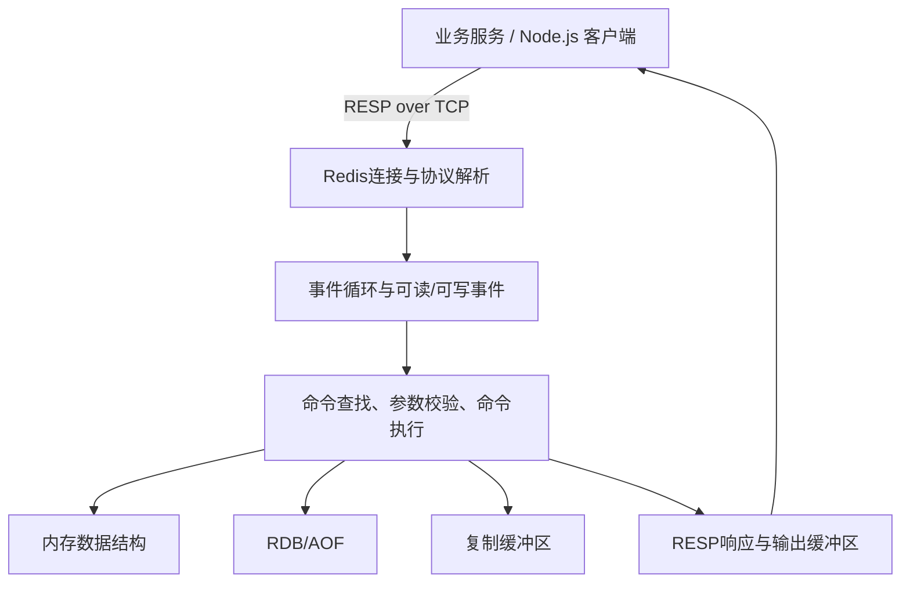
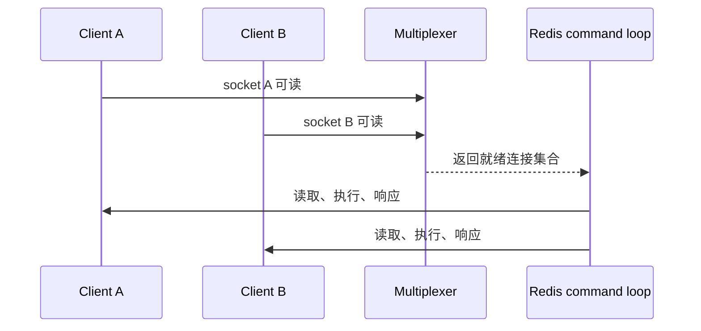
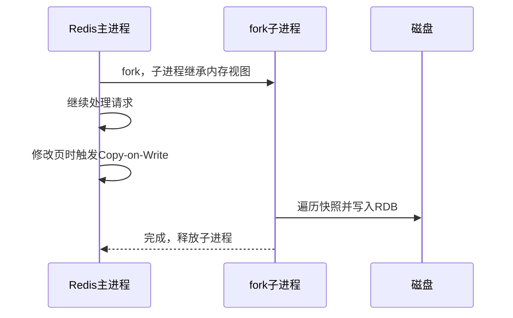
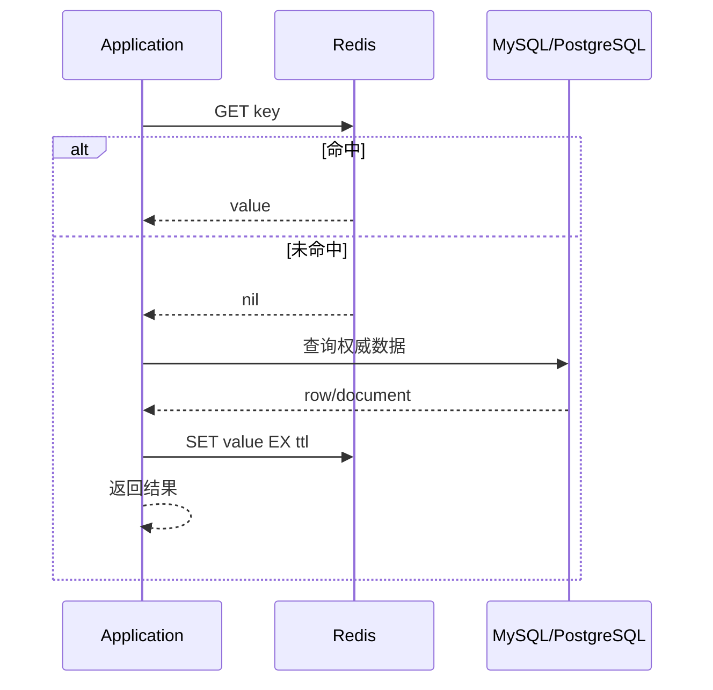
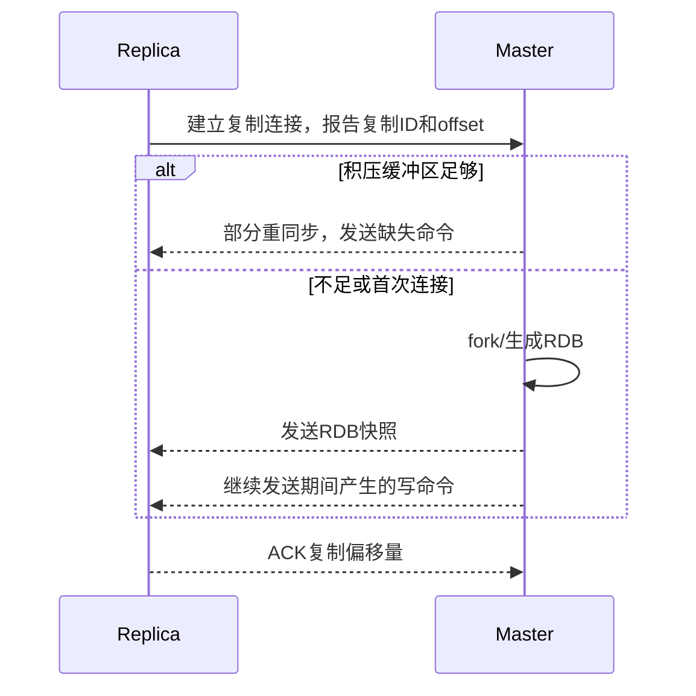
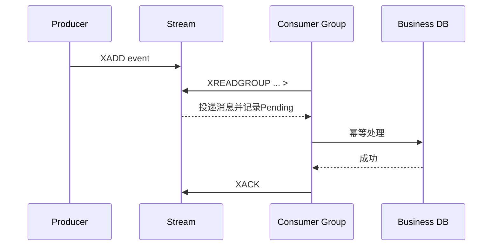
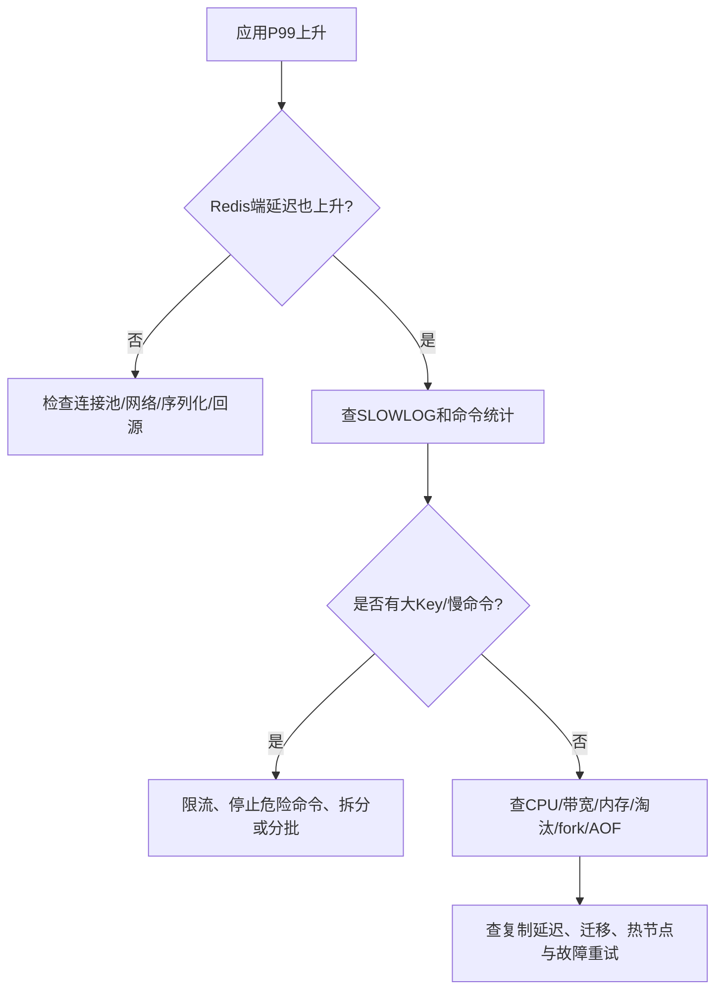

## Redis 面试八股整理

> 面向中高级后端 / 全栈工程师的大厂 Redis 面试手册。本文按“基础模型 → 数据结构 → 底层实现 → 持久化与内存 → 缓存与并发 → 高可用与集群 → 性能与实战”的依赖关系组织。重点不是背命令，而是能解释：为什么这样设计、什么时候会失效、故障时怎样止损。

> **版本说明**：本文以 Redis Open Source 当前官方文档中的通用行为为主，涉及 Redis 7+ 的 Functions、Redis 7.4+ 的 Hash field expiration、Redis 8 的部分查询/过期行为时，会明确标注。不同客户端、Redis Stack 模块、云厂商发行版可能存在差异；面试回答优先说明“核心规律 + 版本边界”，不要把某个版本的内部阈值说成协议保证。

## 目录

1. [学习地图与优先级](#1-学习地图与优先级)
2. [Redis 全景：它是什么，为什么快](#2-redis-全景它是什么为什么快)
3. [RESP、客户端连接与网络事件处理](#3-resp客户端连接与网络事件处理)
4. [五大核心数据类型与命令](#4-五大核心数据类型与命令)
5. [底层数据结构：SDS、字典、listpack、quicklist 与跳表](#5-底层数据结构sds字典listpackquicklist-与跳表)
6. [过期键、淘汰策略与内存管理](#6-过期键淘汰策略与内存管理)
7. [持久化：RDB、AOF、混合持久化与恢复](#7-持久化rdbaof混合持久化与恢复)
8. [事务、Pipeline、Lua / Functions 与原子性](#8-事务pipelinelua--functions-与原子性)
9. [缓存设计与一致性](#9-缓存设计与一致性)
10. [穿透、击穿、雪崩、热 Key 与大 Key](#10-穿透击穿雪崩热-key-与大-key)
11. [分布式锁：实现、续期与可靠性边界](#11-分布式锁实现续期与可靠性边界)
12. [主从复制、Sentinel 与故障转移](#12-主从复制sentinel-与故障转移)
13. [Redis Cluster：槽位、路由与扩缩容](#13-redis-cluster槽位路由与扩缩容)
14. [Stream、消息队列与延迟任务](#14-stream消息队列与延迟任务)
15. [Bitmap、HyperLogLog、GEO、Bloom Filter 与拓展结构](#15-bitmapphyperlogloggeo-bloom-filter-与拓展结构)
16. [性能优化、容量规划与延迟分析](#16-性能优化容量规划与延迟分析)
17. [Redis 与 MySQL / PostgreSQL 协作](#17-redis-与-mysql--postgresql-协作)
18. [监控、故障排查、安全与运维](#18-监控故障排查安全与运维)
19. [综合场景题、易混淆点与复习路线](#19-综合场景题易混淆点与复习路线)
20. [官方资料与版本核对清单](#20-官方资料与版本核对清单)

---

## 1. 学习地图与优先级

### 1.1 优先级划分

| 标记 | 学习目标 | 必须掌握的内容 |
| --- | --- | --- |
| **P0 必学** | 能通过大多数中高级后端一面 | 数据类型、TTL/淘汰、缓存三大问题、RDB/AOF、主从/Sentinel/Cluster 基础、事务/Lua、分布式锁、慢命令与大 Key |
| **P1 重点** | 能应对原理题和系统设计题 | SDS/字典/跳表/listpack、复制偏移量、全量/增量同步、slot 路由、热 Key、容量模型、幂等与一致性 |
| **P2 进阶** | 能应对专家面和生产排障 | fork/COW、AOF 重写、客户端缓存、Stream PEL、fencing token、跨机房、延迟监控、恢复演练 |
| **P3 拓展** | 根据岗位和业务选学 | Redis Functions、Bloom Filter 模块、JSON/搜索/时间序列/vector set、Active-Active 等 |

### 1.2 推荐学习顺序


### 1.3 学习前置：为什么要先学这些

学习 Redis 前至少要能解释四个概念：

1. **进程和线程**：Redis 的核心命令执行以串行为主，单个慢命令会影响其他请求。
2. **TCP 与 I/O 多路复用**：客户端发来的命令不是函数调用，而是通过连接和协议传输。
3. **时间复杂度**：`GET` 的 O(1) 与 `SMEMBERS` 的 O(N) 不是同一种“快”。
4. **分布式系统的故障**：超时不代表服务端没执行，副本存在不代表数据已经同步。

新人最容易犯的错误是背结论：Redis = 内存数据库、单线程 = 不会并发、加了锁 = 不会重复、设置 TTL = 到点立刻删除。学习时要同时问三件事：**这个机制解决什么问题、在什么条件下成立、失效后怎么兜底**。

### 1.4 面试回答的统一模板

重要问题可以按以下顺序回答：

1. **先给结论**：一句话定义机制和适用场景；
2. **讲执行链路**：请求经过哪些组件，状态如何变化；
3. **讲关键取舍**：性能、正确性、内存、可用性分别牺牲什么；
4. **给一个业务例子**：Key、命令、失败处理；
5. **主动补边界**：版本差异、故障场景和不能保证的事情。

---

## 2. Redis 全景：它是什么，为什么快

### 2.1 面试问题：Redis 是什么

**优先级：P0 必学**

#### 核心结论

Redis 是一个基于内存的数据结构服务器。它通过网络协议提供 String、Hash、List、Set、Sorted Set、Stream 等原生数据类型的操作，并支持持久化、复制、哨兵和集群。它可以做缓存，也可以做计数器、排行榜、锁、队列和轻量消息流，但不同用途对应不同的可靠性边界。

Redis 与 MySQL / PostgreSQL 的核心区别，不是“Redis 只能存内存、关系库只能存磁盘”，而是抽象不同：Redis 以 Key 和数据结构为中心，关系库以表、约束、SQL、事务和持久化为中心。

#### 前置知识与为什么

Redis 适合做“高频、简单、可按 Key 或数据结构访问”的操作。若需求是复杂连接、范围过滤、强约束事务和长期事实存储，关系数据库通常更合适。先理解职责边界，才能避免把 Redis 变成一个没有查询能力、没有可靠约束的“伪数据库”。

#### 执行全景



一次 `GET user:1` 大致经历：客户端编码命令 → TCP 发送 → Redis 读取并解析 → 字典定位 Key → 校验类型 → 读取 Value → 编码响应 → 网络写回。真正的端到端延迟还包含连接池排队、网络 RTT、序列化和应用逻辑。

#### Redis 为什么快

1. **数据主要在内存中**：避免每次请求都访问磁盘。
2. **数据结构专用操作**：例如 Hash 查字段、ZSet 按分数范围查询，不需要解析 SQL 和生成执行计划。
3. **命令执行路径短**：常见命令的服务端处理成本很低。
4. **I/O 多路复用**：一个进程可以管理大量连接，不必为每个连接创建阻塞线程。
5. **命令执行串行**：核心数据结构操作不用在每条命令上加复杂的共享锁。

但“Redis 快是因为单线程”是不完整答案。慢命令、大 Value、网络拥塞、AOF/RDB fork、主从复制、客户端连接池和后端回源都可能让应用变慢。官方延迟排查建议重点关注慢命令、O(N) 操作、`KEYS`、fork 和系统 I/O。[Redis 延迟排查文档](https://redis.io/docs/latest/management/optimization/latency/)

#### 高频追问及参考答案

| 追问 | 参考答案 | 面试官考察点 |
| --- | --- | --- |
| Redis 是单线程吗？ | 核心命令执行路径以单线程串行为主，但整体还可能有后台线程、I/O 线程和 fork 出的子进程；不能简化成“整个 Redis 只有一个线程”。 | 是否理解实现边界 |
| Redis 为什么不直接用多线程执行命令？ | 多线程会引入共享数据结构的锁竞争和调度成本；Redis 通过短命令、内存访问和分片扩展吞吐。但 CPU 密集和慢命令仍会阻塞核心执行路径。 | 是否能讲取舍 |
| Redis 能做数据库吗？ | 可以作为数据结构数据库，但是否能作为唯一事实来源要看 RPO/RTO、持久化、备份、约束和灾备要求；订单/账务通常仍以关系库为准。 | 是否有系统边界意识 |

### 2.2 Redis 的“原子性”边界

**优先级：P0 必学**

单条 Redis 命令在一个实例的命令执行阶段不会被其他普通命令插入，因此 `INCR`、`HINCRBY`、`SADD` 等单命令是原子的。但下面这种业务流程不是原子的：

```text
GET stock:sku-1      # 读到 1
业务判断 stock > 0
DECR stock:sku-1     # 再扣减
```

两个客户端可能都读到 1。要把“判断 + 修改”放在同一个命令、事务或 Lua 脚本中。更进一步，Redis 原子执行不代表数据库也成功、不代表已经持久化、不代表副本已经收到。

### 2.3 Redis 的适用与不适用场景

| 场景 | 是否适合 | 说明 |
| --- | --- | --- |
| 热点读缓存 | 适合 | 丢失后可从数据库重建 |
| 计数器 / 排行榜 | 适合 | 需要考虑异步落库和重启恢复 |
| 会话 / 短期 Token | 适合 | TTL、权限和泄露风险要设计 |
| 简单队列 / Stream | 有条件适合 | 需要重试、ACK、积压和死信治理 |
| 订单事实 / 账务主存储 | 通常不建议单独使用 | 缺少关系约束和跨表事务能力 |
| 全文检索 / 复杂分析 | 通常不优先 | 应考虑专门的搜索或分析系统 |

---

## 3. RESP、客户端连接与网络事件处理

### 3.1 面试问题：Redis 客户端和服务端如何通信

**优先级：P1 重点**

Redis 使用 RESP（Redis Serialization Protocol）在客户端和服务端之间编码请求与响应。以 `SET name Alice` 为例，请求可表示为数组和批量字符串：

```text
*3\r\n
$3\r\n
SET\r\n
$4\r\n
name\r\n
$5\r\n
Alice\r\n
```

RESP 的价值是结构简单、解析成本低、支持字符串、整数、数组、错误和空值。Redis 6 引入 RESP3，增加了更丰富的数据类型和语义，但客户端是否使用 RESP3 由客户端和配置决定，业务代码不能假设所有部署都返回相同表现。

### 3.2 I/O 多路复用的前置知识

阻塞 I/O 的直观模型是：一个线程等待一个连接；连接数量增加后，线程栈、上下文切换和调度成本上升。I/O 多路复用则让线程等待一批连接的“可读/可写事件”，事件就绪后再处理对应连接。



这解释了 Redis 能用较少线程管理很多连接，但并不意味着命令本身并行。事件循环仍然要依次读取、执行和写响应。

### 3.3 Node.js 客户端示例

```ts
import { createClient } from 'redis';

const redis = createClient({
  url: process.env.REDIS_URL,
  socket: {
    connectTimeout: 1000,
    reconnectStrategy: (retries) => Math.min(100 * retries, 3000),
  },
});

redis.on('error', (err) => {
  // 生产环境应接入结构化日志和告警，不要静默吞掉连接错误
  console.error('redis error', err);
});

await redis.connect();
await redis.set('user:1', JSON.stringify({ id: 1, name: 'Alice' }), {
  EX: 300,
});
const value = await redis.get('user:1');
await redis.quit();
```

关键点：连接应复用而不是每次请求创建；连接超时、命令超时和重试要分别配置；写命令是否可重试取决于幂等性。客户端收到超时，不能推断服务端一定没执行，因为请求可能已经执行成功但响应丢失。

### 3.4 高频追问：客户端连接池为什么重要

连接池复用 TCP 连接，减少握手和连接建立成本，同时限制并发连接数，避免应用实例把 Redis 连接打爆。连接池不是越大越好：连接数过大可能增加服务端上下文、输出缓冲区和网络压力；连接太小则会在应用侧排队。

设计时至少明确：最大连接数、获取连接超时、命令超时、重连退避、读写是否分离、Cluster/Sentinel 拓扑更新、健康检查和优雅关闭。

---

## 4. 五大核心数据类型与命令

### 4.1 数据建模方法：先写操作，再选类型

**优先级：P0 必学**

不要从“我记得有 String、Hash、Set”开始，而要先写业务动作：

| 业务动作 | 推荐类型 | 原因 |
| --- | --- | --- |
| 整体缓存一个对象 | String | 序列化后一次读写，结构简单 |
| 局部更新对象字段 | Hash | 字段级读写和计数 |
| 判断成员是否存在、去重 | Set | 唯一性和集合操作 |
| 按分数/时间排名和范围取值 | Sorted Set | score + member |
| 两端进出、保留最新 N 条 | List | LPUSH/RPOP/LTRIM |
| 可靠消息流和消费组 | Stream | ID、消费组、Pending、ACK |

为什么先看操作？数据类型会影响原子性、时间复杂度、内存和 Cluster 中的 Key 分布。类型选错后，往往只能把数据全部取到客户端再计算，失去 Redis 的优势。

### 4.2 String

**优先级：P0 必学**

String 是字节序列，可以保存文本、JSON、二进制，也可以作为整数计数器和 Bitmap 的底层容器。

```redis
SET user:1:profile '{"id":1,"name":"Alice"}' EX 300
GET user:1:profile
SET article:100:views 0
INCR article:100:views
INCRBY user:1:points 10
```

#### 适用场景与边界

- 对象缓存：简单，但字段更新需要重新序列化整个对象；
- 计数器：使用 `INCR/DECR`，不要用 GET + 客户端计算 + SET；
- 分布式 ID：适合简单单调序列，不天然提供跨机房全局有序；
- 锁：使用带 `NX` 和 TTL 的 `SET`，不能把 `SETNX` 与 `EXPIRE` 分成两个不受保护的步骤。

### 4.3 Hash

```redis
HSET user:1 id 1 name Alice vip 1 login_count 10
HGET user:1 name
HINCRBY user:1 login_count 1
HSCAN user:1 0 COUNT 100
```

Hash 适合一个对象的多个字段，但 TTL 是 Key 级别的：传统用法不能给每个 field 设置独立过期。Redis 7.4+ 引入了 Hash field expiration 相关能力，但需要确认服务端版本、客户端支持和部署发行版，不能在通用面试回答中假设所有线上环境都有。

不要无脑 `HGETALL`：如果 Hash 有几十万字段，一次返回会放大网络和事件循环压力。字段遍历使用 `HSCAN`，对象生命周期不同则考虑拆成多个 Key。

### 4.4 List

```redis
LPUSH queue:email job-3 job-2 job-1
RPOP queue:email
BLPOP queue:email 10
LPUSH recent:orders order:1001
LTRIM recent:orders 0 99
```

List 的优势是两端操作和有序序列；`LTRIM` 可以维护最近 N 条。简单 `RPOP` 消费存在“取出后进程崩溃导致消息丢失”的窗口。可靠消费可以使用 `BLMOVE` / `BRPOPLPUSH` 形成 processing 队列，但需要自己实现超时回收、重试和死信；消息复杂时优先考虑 Stream 或专业 MQ。

### 4.5 Set

```redis
SADD article:1:tags redis cache database
SISMEMBER article:1:tags redis
SINTER user:1:followings user:2:followings
SSCAN article:1:tags 0 COUNT 100
```

Set 保证成员唯一，适合标签、去重、关系集合和抽奖池。`SMEMBERS` 是 O(N)，大集合不应在请求链路中无界调用；可以用 `SSCAN` 分批遍历，但 SCAN 不是强一致快照，可能重复返回。

### 4.6 Sorted Set

```redis
ZADD leaderboard 98 user:1 95 user:2 98 user:3
ZREVRANGE leaderboard 0 9 WITHSCORES
ZINCRBY leaderboard 5 user:2
ZRANGEBYSCORE leaderboard -inf 100 LIMIT 0 100
```

Sorted Set 维护 member 与 score 的关系，常用于排行榜、按时间调度和范围查询。典型复杂度是插入/删除 O(log N)，返回 M 个元素的范围查询通常是 O(log N + M)，具体以对应版本命令文档为准。

分数相同时要明确 tie-break 规则；如果要实现延迟队列，不能把“查询到期任务”和“删除任务”拆成两个并发可插入的步骤，应该用 Lua 或可靠的 processing 状态。

### 4.7 Stream

```redis
XADD orders * order_id 1001 user_id 7 amount 99
XGROUP CREATE orders order-workers $ MKSTREAM
XREADGROUP GROUP order-workers consumer-1 COUNT 10 BLOCK 5000 STREAMS orders >
XACK orders order-workers 1700000000000-0
```

Stream 适合需要消息 ID、消费组、ACK、Pending 和接管的场景。`>` 只用于消费组读取尚未投递给该组的消息；`XACK` 表示消费组状态确认，不等于数据库事务成功。要设计 `XPENDING`、`XAUTOCLAIM`、重试次数、死信和保留策略。

### 4.8 数据类型速查与误区

| 误区 | 正确理解 |
| --- | --- |
| Redis 所有命令都是 O(1) | 返回 M 个元素或扫描 N 个元素时，成本通常随结果规模增长 |
| Hash 一定比多个 String 省内存 | 取决于字段数量、编码、Key 元数据和访问方式 |
| List 就是可靠消息队列 | List 不自动提供 ACK、Pending 和死信 |
| ZSet 的 score 可以无限精确 | score 通常按浮点语义处理，金额等精确值不要依赖二进制浮点排序 |
| `SCAN` 返回一次就能当完整快照 | 遍历过程中可能重复，不能当强一致快照 |

---

## 5. 底层数据结构：SDS、字典、listpack、quicklist 与跳表

### 5.1 为什么面试要问底层结构

**优先级：P1 重点**

底层结构不是为了背源码，而是为了回答三类问题：

1. 为什么 Redis 的字符串比 C 字符串更适合做动态数据？
2. 为什么小 Hash / 小 ZSet 可以节省内存，但大规模后会换编码？
3. 为什么某些命令平均很快，遇到大数据结构却会突然变慢？

具体结构和阈值会随 Redis 版本变化。面试时应说“常见实现和设计目的”，并注明阈值以目标版本配置/源码为准。

### 5.2 SDS：Redis 的动态字符串

C 字符串依赖 `\\0` 结尾，计算长度需要遍历；扩容和二进制内容也不方便。SDS 通常保存长度、可用空间和字符数组，带来：

- O(1) 获取长度；
- 二进制安全，可以包含 `\\0`；
- 扩容时预留空间，减少频繁 realloc；
- 通过长度控制读写，避免缓冲区溢出类问题。

这解释了为什么 Redis String 能存二进制而不只是文本，也解释了为什么反复追加时不会每次都完整复制。SDS 仍然会占内存，超大 String 依然是大 Key。

### 5.3 全局 Key 字典与渐进式 rehash

Redis 的数据库 Key 空间通常基于哈希表。哈希表扩容不能一次性搬迁所有 Key，否则会长时间阻塞命令，因此使用渐进式 rehash：


渐进式 rehash 的核心取舍是：避免长暂停，但在迁移期间读路径和内存会暂时变复杂。它不是“零成本扩容”，高峰期大量 Key 变化仍可能造成 CPU 和内存压力。

### 5.4 listpack：紧凑的连续内存结构

listpack 用连续内存编码多个元素，适合小规模 Hash、List 节点或 ZSet。优势是指针少、内存局部性好、对象头开销小；限制是元素数量或大小增长后，插入/查找可能需要移动或扫描更多内容，因此不能把小数据结构的 O(1) 直觉外推到超大数据。

历史版本常见 ziplist；Redis 7 相关实现更多使用 listpack 替代 ziplist。回答时应避免说“Redis 永远用 ziplist”，并说明内部编码是实现细节，版本升级可能变化。

### 5.5 quicklist：List 的分段组织

List 需要支持两端快速操作，又不希望一个超大连续内存块频繁搬迁。quicklist 可以把 List 分成多个节点，每个节点内部再用紧凑结构保存一批元素，在两端访问和内存局部性之间取平衡。

面试中重点说设计目标即可：**分段降低大连续块成本，双向连接支持两端操作，内部紧凑编码节省内存**。不要把某个版本的节点压缩策略或参数阈值说成固定协议。

### 5.6 字典 + 跳表：Sorted Set 的组合

Sorted Set 通常需要同时满足：

- 按 member 快速查 score；
- 按 score 排序和范围访问。

因此常见实现组合是字典 + 跳表：字典负责 member 到 score/节点的定位，跳表负责有序遍历和范围查询。跳表通过多层索引把平均查找复杂度降到 O(log N)，实现比平衡树更简单，也便于范围遍历。

```text
level 3:       1 -------------------- 40
level 2:       1 -------- 20 -------- 40
level 1:       1 -- 8 -- 20 -- 31 -- 40
level 0:       1  5  8  12 20 31 40 55
```

### 5.7 高频追问

| 问题 | 参考答案 |
| --- | --- |
| 为什么 Hash 小时省内存？ | 可以采用紧凑连续编码，减少哈希桶、指针和对象头；超过阈值后为保证操作效率会转换为更适合大数据的编码。 |
| 为什么 Redis 用跳表而不是红黑树？ | 两者都可支持 O(log N)，跳表实现相对简单，范围遍历和层级索引直观；具体实现是工程取舍，不应绝对化为“跳表一定更快”。 |
| 渐进式 rehash 为什么不一次完成？ | 一次完成会让主命令长时间阻塞；渐进迁移把成本分摊到多个操作，但迁移期需要同时处理旧表和新表。 |

---

## 6. 过期键、淘汰策略与内存管理

### 6.1 面试问题：Redis 的过期键如何删除

**优先级：P0 必学**

#### 核心结论

Redis 的过期处理通常结合**惰性删除**和**主动/定期删除**：访问 Key 时发现已过期就删除；后台周期性抽样过期 Key，清理一部分已过期数据。TTL 到期并不意味着在同一毫秒物理内存一定已经释放。

官方命令文档还说明，过期时间通常是 Key 级别；改变值但不替换整个 Key 的操作，例如 `INCR`、`LPUSH`、`HSET`，通常不会清除现有 TTL，而 `SET`、`GETSET` 等覆盖操作可能清除 TTL。[EXPIRE 命令文档](https://redis.io/docs/latest/commands/expire/)

#### 为什么这样设计

只做惰性删除会让永远不再访问的过期 Key 长期占内存；只做全量主动扫描又会阻塞主线程。因此 Redis 使用抽样和渐进处理，在内存回收和请求延迟之间取平衡。

#### 过期与复制

主节点负责决定 Key 过期并传播删除行为，副本不会简单地独立按照本地访问过期来改变主数据集。故障转移后新主需要继续依据过期时间处理。面试时应避免说“所有副本自己同时删除，所以一定一致”，也不能忽略时钟和复制延迟。

### 6.2 maxmemory 与淘汰策略

当实例达到 `maxmemory`，Redis 根据 `maxmemory-policy` 决定淘汰或拒绝写入：

| 策略 | 作用范围 | 典型用途 |
| --- | --- | --- |
| `noeviction` | 不自动淘汰，写入可能返回 OOM | 不能丢数据的实例，需容量预留 |
| `allkeys-lru` | 所有 Key 按近似 LRU 淘汰 | 纯缓存常见选择 |
| `allkeys-lfu` | 所有 Key 按近似 LFU 淘汰 | 长期热点分布明显 |
| `volatile-lru` | 仅有 TTL 的 Key | 混合数据，需确认重要数据都设置 TTL |
| `volatile-lfu` | 仅有 TTL 的 Key 按 LFU | 混合缓存场景 |
| `volatile-ttl` | 优先剩余 TTL 短的 Key | TTL 本身体现业务优先级 |
| `allkeys-random` / `volatile-random` | 随机淘汰 | 特殊场景 |

LRU/LFU 一般是近似策略，不是每次访问都维护全量精确排序。选择策略前先回答：Redis 是否纯缓存？数据能否重建？淘汰后数据库能否承受回源？不要把淘汰当成容量规划的替代品。

### 6.3 内存结构与碎片

内存不只由 Value 构成，还包括 Key、对象头、哈希表/跳表节点、过期字典、客户端缓冲区、复制积压区和分配器碎片。删除数据后 RSS 可能不会立刻下降，因为内存分配器不一定把页归还给操作系统。[官方内存优化文档](https://redis.io/docs/latest/operate/oss_and_stack/management/optimization/memory-optimization/)

常见指标：

```redis
INFO memory
MEMORY USAGE user:1
MEMORY DOCTOR
CONFIG GET maxmemory
CONFIG GET maxmemory-policy
```

`used_memory` 更接近 Redis 统计的数据/分配内存，RSS 反映进程占用的物理页；两者差距大时需要分析碎片、fork/COW 和分配器行为。

### 6.4 大 Key 与热 Key

**大 Key** 是单个 Key 的 Value 或集合元素过大；**热 Key** 是少数 Key 承担过高访问或更新。二者可以同时存在，但治理方向不同：

| 问题 | 风险 | 典型治理 |
| --- | --- | --- |
| 大 Key | 读写、删除、复制、迁移、序列化耗时 | 拆分、分页、`UNLINK`、限制集合规模 |
| 热 Key | 单分片/单节点成为瓶颈 | 本地缓存、Key 副本、分片计数、限流 |

生产环境不要用 `KEYS *` 排查大 Key。可以用采样、`SCAN`、`MEMORY USAGE`、客户端埋点和运维工具渐进定位。`UNLINK` 可以把释放大对象的工作异步化，但不能消除网络传输和复制成本。

### 6.5 高频追问

| 问题 | 参考答案 |
| --- | --- |
| TTL 到了为什么内存还在？ | 过期删除可能是惰性或抽样主动处理，删除和内存归还也不是同一时刻。 |
| `EXPIRE` 后执行 `HSET` 会不会丢 TTL？ | 通常不会；修改已有值的字段不会替换整个 Key。覆盖型命令可能清除 TTL，具体以命令语义为准。 |
| 缓存应该选 `allkeys-lru` 还是 `volatile-lru`？ | 纯缓存常考虑 allkeys；volatile 只淘汰有 TTL 的 Key，混合数据时要确保可淘汰范围正确，不能脱离数据模型决定。 |
| `maxmemory` 设置为机器物理内存一样大可以吗？ | 不建议，必须为系统、fork/COW、复制、客户端缓冲区和碎片留余量。 |

---

## 7. 持久化：RDB、AOF、混合持久化与恢复

### 7.1 面试问题：RDB 和 AOF 如何选择

**优先级：P0 必学**

#### RDB

RDB 是某个时间点的数据集快照，通常生成一个紧凑文件。优势是备份和恢复相对直接、文件紧凑；缺点是两次快照之间的写入可能丢失，生成快照涉及 fork 和 Copy-on-Write。



#### AOF

AOF 记录改变数据集的写命令，重启时重放命令。`appendfsync` 常见取值：

| 配置 | 可靠性/性能取舍 |
| --- | --- |
| `always` | 每次写尽量同步，延迟和磁盘压力更高 |
| `everysec` | 常见折中，极端故障可能丢约一秒级写入 |
| `no` | 由操作系统决定刷盘时机，行为更不可控 |

AOF 会增长，需要重写。重写时根据当前数据集生成更短的表示，并把期间的新写入放入缓冲区，重写完成后合并。

#### 混合持久化

混合模式通常在 AOF 前部放一个 RDB 格式的快照，再追加增量 AOF。恢复时先加载快照，再重放增量，兼顾恢复速度和较小的数据丢失窗口。具体配置名称和默认值要以目标 Redis 版本为准。

### 7.2 前置知识：RPO、RTO 与事实来源

先定义：

- **RPO**：故障后最多能丢多少数据；
- **RTO**：故障后最多多久恢复；
- **事实来源**：Redis 中的数据是否可以从数据库/日志重建。

纯缓存可以关闭持久化，但要有预热和回源保护；计数、队列、会话要根据丢失后果选择策略；订单和账务不能只因为开启 AOF 就把 Redis 当成关系数据库替代品。

### 7.3 Copy-on-Write 为什么造成额外内存

fork 后父子进程共享物理页。父进程写入某页时，操作系统复制该页给父进程，形成 COW。因此 RDB/AOF 重写期间写入越活跃，额外内存压力越大；大实例还可能遇到 fork 延迟和透明大页导致的延迟尖刺。容量规划必须考虑 `used_memory` 之外的峰值。

### 7.4 数据恢复流程

```text
发现实例故障
  -> 判断是缓存还是权威状态
  -> 选择最近可用 RDB/AOF/副本
  -> 在隔离环境校验文件完整性
  -> 测量加载耗时与数据丢失窗口
  -> 恢复服务并做一致性校验
  -> 回放补偿事件、重建缓存、恢复流量
```

备份存在不等于可恢复。必须定期演练文件可读性、恢复时间、权限、版本兼容、误删和错误脚本后的恢复路径。

### 7.5 高频追问

| 问题 | 参考答案 |
| --- | --- |
| RDB 和 AOF 哪个更可靠？ | 没有绝对答案；RDB 是时间点快照，AOF 记录写入过程，取舍由 RPO、RTO、磁盘和恢复需求决定。 |
| AOF everysec 能保证最多丢一秒吗？ | 这是常见近似描述，不是绝对保证；机器断电、内核、文件系统和故障时序都会影响实际结果。 |
| Redis 开了持久化就能当主库吗？ | 持久化只解决一部分重启恢复问题，仍缺少关系约束、复杂事务、灾备和业务审计能力。 |
| fork 会不会阻塞 Redis？ | fork 本身和 COW 都可能引发延迟，程度取决于内存规模、内核、透明大页和写入强度。 |

---

## 8. 事务、Pipeline、Lua / Functions 与原子性

### 8.1 三个概念必须分开

**优先级：P0 必学**

| 机制 | 解决什么 | 不解决什么 |
| --- | --- | --- |
| Pipeline | 减少客户端与服务端的网络往返 | 不保证命令不可插入，不自动回滚 |
| `MULTI/EXEC` | 一组命令按顺序执行，执行期间不被其他客户端命令插入 | 没有传统数据库式自动回滚，不跨系统 |
| Lua / Functions | 把判断和修改放在服务端一次执行 | 脚本太慢会阻塞，不能替代跨系统事务 |

### 8.2 Pipeline

```ts
const pipeline = redis.multi();
pipeline.set('a', '1');
pipeline.set('b', '2');
pipeline.get('a');
const replies = await pipeline.exec();
```

不同客户端对 `multi()`、pipeline 和事务的 API 叫法可能不同，不能只看方法名；要确认是否发送 `MULTI/EXEC`，还是仅仅批量发送命令。Pipeline 适合大量互不依赖的读写，减少 RTT；批次太大可能造成客户端内存、服务端输出缓冲区和尾延迟问题。

### 8.3 Redis 事务与 WATCH

```redis
WATCH stock:1
GET stock:1
MULTI
DECR stock:1
EXEC
```

如果 `WATCH` 后 Key 被其他客户端修改，`EXEC` 可能失败，客户端需要重新读取并重试。高竞争场景可能出现大量重试，Lua 往往更适合封装“判断 + 修改”。Redis 事务执行期间没有逐条命令被其他客户端插入，但运行时某条命令出错不会自动回滚此前已执行的命令。

### 8.4 Lua 扣库存示例

```lua
-- KEYS[1] = stock:{sku}:available
-- KEYS[2] = stock:{sku}:users
-- ARGV[1] = userId
local stock = tonumber(redis.call('GET', KEYS[1]) or '0')
if stock <= 0 then
  return -1
end

if redis.call('SISMEMBER', KEYS[2], ARGV[1]) == 1 then
  return -2
end

redis.call('DECR', KEYS[1])
redis.call('SADD', KEYS[2], ARGV[1])
return 1
```

Node.js 调用：

```ts
const result = await redis.eval(script, {
  keys: ['stock:{sku-1}:available', 'stock:{sku-1}:users'],
  arguments: ['user-7'],
});
```

关键点：Key 通过 `KEYS` 传入，参数通过 `ARGV` 传入；Cluster 下相关 Key 要落在同一个 slot；脚本执行期间会阻塞其他命令，禁止无界循环和大范围扫描。

### 8.5 Redis Functions 与版本边界

官方文档说明，Redis 7+ 可以使用 Redis Functions 管理和运行服务端逻辑；Redis 6.2 及以前主要使用 `EVAL` 脚本。Functions 更适合把逻辑作为可部署的服务端能力管理，但仍然要控制执行时间、Key 路由和发布回滚。[Redis Programmability](https://redis.io/docs/latest/develop/programmability/)

### 8.6 高频追问

| 问题 | 参考答案 |
| --- | --- |
| Pipeline 是事务吗？ | 不是。Pipeline 主要减少 RTT；事务还要求命令在执行期间不被其他客户端命令插入。 |
| Redis 事务能回滚吗？ | 不提供传统意义的自动回滚；设计时应通过校验、Lua 或业务补偿保证状态。 |
| Lua 一定比事务好？ | 需要多步原子判断时常更直接，但脚本会阻塞核心执行路径，复杂脚本也难维护，不能无条件使用。 |
| 原子脚本能保证数据库和 Redis 一致吗？ | 不能，只保证脚本所在 Redis 实例内的执行连续性；跨系统需要消息、幂等、状态机和补偿。 |

---

## 9. 缓存设计与一致性

### 9.1 面试问题：Cache Aside 怎么设计

**优先级：P0 必学**

#### 前置知识：缓存是副本，不是事实来源

先明确数据库或下游服务是权威来源，Redis 是一份可丢失、可过期、可重建的副本。设计缓存时必须回答：允许多长旧数据？缓存丢了能否回源？更新失败如何补偿？Redis 不可用时如何保护数据库？

#### 读流程



#### Node.js 示例

```ts
async function getUser(id: string) {
  const key = `user:${id}:profile`;
  const cached = await redis.get(key);

  if (cached !== null) {
    if (cached === '__NULL__') return null;
    return JSON.parse(cached);
  }

  const user = await db.user.findById(id);
  if (!user) {
    // 空值 TTL 要短，避免永久缓存不存在的数据
    await redis.set(key, '__NULL__', { EX: 30 });
    return null;
  }

  const ttl = 300 + Math.floor(Math.random() * 60);
  await redis.set(key, JSON.stringify(user), { EX: ttl });
  return user;
}
```

#### 写流程与一致性

常见策略是：**先更新数据库，成功后删除缓存**。删除失败时通过重试、消息补偿或 CDC 重新发送失效事件。它不是严格强一致，但通常比“先删除缓存再更新数据库”更容易控制旧值回填窗口。

```ts
async function updateUser(id: string, patch: Patch) {
  await db.user.update(id, patch);
  try {
    await redis.del(`user:${id}:profile`);
  } catch (err) {
    // 记录待补偿事件；不要仅仅吞掉错误
    await cacheInvalidationOutbox.append({ type: 'user', id });
    throw err;
  }
}
```

注意：如果缓存删除失败但接口已经返回成功，应该把“业务更新成功”和“缓存失效待补偿”作为两个可观测状态，而不是把问题隐藏起来。

### 9.2 其他缓存模式

| 模式 | 特征 | 适用与风险 |
| --- | --- | --- |
| Cache Aside | 应用显式读写 DB 与缓存 | 最灵活、最常用；一致性需要业务处理 |
| Read Through | 缓存层负责未命中回源 | 对应用透明，但依赖缓存组件能力 |
| Write Through | 写缓存同步写底层存储 | 一致性路径清晰，写延迟较高 |
| Write Behind | 先写缓存，异步落库 | 吞吐高，但丢失和最终一致性风险大 |
| 多级缓存 | 本地缓存 + Redis + DB | 延迟低，但失效通知和版本管理更复杂 |

### 9.3 延迟双删与版本号

延迟双删可以缓解并发读回填旧数据：更新前删一次，更新数据库后再删一次。但它不是严格一致性方案，延迟时间也不是可证明的安全边界。更强的方案包括：

- Value 里携带版本号，读写时比较版本；
- 数据库变更通过 Outbox/CDC 发布失效事件；
- 写后读要求读主或等待某个版本已传播；
- 对关键状态使用数据库状态机和唯一约束，缓存只做加速。

### 9.4 高频追问

| 问题 | 参考答案 |
| --- | --- |
| 为什么常说先更新数据库再删缓存？ | 让缓存失效发生在权威数据更新之后，降低旧值回填概率；仍有并发和删除失败窗口，需补偿。 |
| 能不能更新数据库后直接更新缓存？ | 可以，但缓存更新失败、并发写覆盖和序列化版本都会引入复杂性；对多数读缓存，删除后按需回填更简单。 |
| 缓存和数据库如何强一致？ | 先澄清业务要求；跨系统强一致成本高，通常用版本、消息、状态机、幂等和补偿实现可控的最终一致。 |

---

## 10. 穿透、击穿、雪崩、热 Key 与大 Key

### 10.1 四类问题的本质

**优先级：P0 必学**

| 问题 | 典型表现 | 主要治理 |
| --- | --- | --- |
| 穿透 | 查询不存在的数据，缓存和 DB 都没有 | 参数校验、空值缓存、Bloom Filter、限流 |
| 击穿 | 单个热点 Key 失效瞬间大量回源 | 互斥回源、逻辑过期、singleflight、热点预热 |
| 雪崩 | 大批 Key 同时失效或缓存集群不可用 | TTL 抖动、预热、降级、限流、熔断、多级缓存 |
| 热 Key | 少数 Key 长期承受过高 QPS | 本地缓存、Key 副本、读分片、写分桶 |
| 大 Key | 单个 Key 的 Value/元素数过大 | 拆分、分页、限制大小、分批删除/迁移 |

先看流量链路：


目标不是让所有请求都成功，而是让异常流量不会无界地冲击数据库和线程池。

### 10.2 防穿透：空值与 Bloom Filter

空值缓存简单，但要避免把“数据库异常”当成“不存在”缓存。Bloom Filter 可以快速判断“一定不存在”，但会有误判，不能列出元素，也通常不适合直接删除。

```text
请求 Key
  -> 参数/权限校验
  -> Bloom Filter 判断
      -> 一定不存在：快速返回
      -> 可能存在：查 Redis，再回源 DB
```

Bloom Filter 需要考虑初始化、扩容、误判率、新数据写入同步和重建。RedisBloom 是模块能力，不应假设所有原生 Redis 都内置该命令。

### 10.3 防击穿：互斥回源与逻辑过期

互斥回源：只有一个请求获取锁并查 DB，其余请求短暂等待或返回旧值。锁必须有 TTL、唯一 token 和释放校验。

逻辑过期：Value 包含 `data` 和 `logicalExpireAt`。过期后先返回旧值，同时只有一个后台刷新任务更新缓存。它牺牲实时性换取稳定性，适合商品详情、配置等允许短暂旧数据的场景。

### 10.4 防雪崩：多层保护

1. TTL 增加随机抖动，避免同一时刻批量失效；
2. 发布前预热热点 Key；
3. 对回源接口做并发上限和队列化；
4. Redis 故障时返回旧值、静态值或业务降级结果；
5. 数据库连接池隔离，避免缓存故障占满所有连接；
6. 监控命中率、回源率、淘汰数、P99 和 Redis 错误率。

### 10.5 热 Key 与大 Key 的识别

热 Key 主要看访问分布和单节点负载；大 Key 主要看对象大小和集合元素数。应在应用侧记录 Key 访问采样，并结合 `MEMORY USAGE`、命令统计、代理日志和集群节点指标。官方监控文档将 slow operations、hot keys、large keys 列为重要性能反模式。[Redis 监控与可观测性](https://redis.io/docs/latest/operate/rs/monitoring/observability/)

---

## 11. 分布式锁：实现、续期与可靠性边界

### 11.1 面试问题：Redis 分布式锁如何实现

**优先级：P0 必学**

最小实现：

```redis
SET lock:order:1001 550e8400-e29b-41d4-a716-446655440000 NX PX 30000
```

- `NX`：只有 Key 不存在时才能获取；
- `PX 30000`：防止持锁进程崩溃后锁永久存在；
- Value 是唯一 token，用于证明当前释放者拥有这把锁。

释放不能直接 `DEL`：

```lua
if redis.call('GET', KEYS[1]) == ARGV[1] then
  return redis.call('DEL', KEYS[1])
end
return 0
```

Node.js 封装示例：

```ts
const token = crypto.randomUUID();
const ok = await redis.set(lockKey, token, { NX: true, PX: 30_000 });

if (ok === 'OK') {
  try {
    await doCriticalWork();
  } finally {
    await redis.eval(releaseScript, {
      keys: [lockKey],
      arguments: [token],
    });
  }
}
```

### 11.2 误删、过期和续期

假设 A 获取锁，业务执行超过 TTL；锁过期后 B 获取同一把锁；A 执行完直接 `DEL`，就会误删 B 的锁。唯一 token + Lua 只能防止误删，不能防止锁在业务完成前过期。

解决方向：

- 估算最大执行时间，并让 TTL 覆盖临界区；
- 使用 watchdog 续期，但续期线程和进程假死仍需考虑；
- 临界区设计成幂等；
- 对关键外部资源使用 fencing token / 版本号，让过期持有者的写入被拒绝。

### 11.3 Redis 锁的可靠性边界

Redis 锁能降低重复执行概率，但不能天然保证：

- 锁内数据库事务一定成功；
- 网络分区下所有客户端看到同一个锁状态；
- 进程暂停时租约不会过期；
- 任务只执行一次；
- 主从切换后刚写入的锁一定存在。

因此支付、库存、订单等关键流程还需要数据库唯一约束、状态机、幂等 Key 和补偿机制。锁是协调手段，不是业务正确性的唯一来源。

### 11.4 Redlock 如何回答

Redlock 尝试在多个独立 Redis 实例上获取同一资源锁，并使用多数派和剩余有效时间判断成功。面试时不要绝对化地说“Redlock 一定安全”或“一定没用”。应说明：它改善了单实例故障场景，但强一致临界资源还要考虑时钟、网络隔离、进程暂停和 fencing token；如果业务需要可证明的协调语义，应评估具备共识/租约语义的专门系统。

---

## 12. 主从复制、Sentinel 与故障转移

### 12.1 主从复制流程

**优先级：P0 必学**



复制通常是异步的：主节点返回客户端成功时，副本可能尚未收到。副本断线时间短且复制积压缓冲区仍保留缺失命令时，可进行部分重同步；否则需要全量同步。

### 12.2 Sentinel 解决什么问题

Sentinel 主要负责监控、主观/客观下线判断、选举故障转移 leader、提升副本为新主、重配其他副本并向客户端提供服务发现。它不负责把一个主节点的数据拆到多个分片。

客户端必须显式支持 Sentinel：发现主地址、连接主节点、验证角色、断线后重新发现。官方 Sentinel client spec 还强调，客户端连接恢复时应重新解析主地址，不能永久硬编码旧主地址。[Sentinel Client Spec](https://redis.io/docs/latest/develop/reference/sentinel-clients/)

### 12.3 故障转移中的数据丢失

主节点故障时，Sentinel 会在副本中选择相对合适者，但异步复制和网络分区意味着副本可能缺少最近写入。`WAIT` 可以让客户端等待一定数量副本确认传播，但它不等同于跨故障域的强一致提交，也不能解决所有 failover 选择问题。

### 12.4 读副本与一致性

读副本可以扩展读流量，但存在复制延迟：刚写主后立即读副本可能读到旧值。需要“写后读”保证时，可以读主、携带版本号、等待复制偏移，或让业务接受最终一致性。不要因为“有主从”就默认读写一致。

### 12.5 高频追问

| 问题 | 参考答案 |
| --- | --- |
| Sentinel 和 Cluster 区别？ | Sentinel 主要做单分片的高可用与故障转移；Cluster 做分片和分片级高可用。 |
| 主从同步是同步还是异步？ | 默认是异步；可以用 WAIT 做部分传播确认，但不能将其等同于完整强一致事务。 |
| 全量同步为什么消耗大？ | 需要生成/传输/加载快照，并处理期间写命令；会消耗 CPU、网络、磁盘和额外内存。 |
| 副本可以处理写吗？ | 普通复制架构通常由主处理写；副本读要明确陈旧数据和故障切换语义。 |

---

## 13. Redis Cluster：槽位、路由与扩缩容

### 13.1 面试问题：Cluster 如何分片

**优先级：P0 必学**

Redis Cluster 把 Key 映射到固定数量的 hash slot，再由主节点负责不同 slot：

```text
slot = CRC16(key) mod 16384

slot 0 ... 5000       -> master A
slot 5001 ... 10000   -> master B
slot 10001 ... 16383  -> master C
```

客户端通常维护 slot cache。访问错误节点时可能收到：

- `MOVED`：该 slot 的长期归属已经变更，客户端应更新映射；
- `ASK`：迁移过程中的临时指引，本次请求去目标节点，但不应立即永久修改映射。

### 13.2 Hash Tag 与多 Key 原子操作

```text
cart:{user:1}
coupon:{user:1}
```

大括号中的内容作为 hash tag，两者会落到同一个 slot，因此可以在同一节点执行多 Key Lua/事务。但 Tag 过度集中会形成热点，设计时要让“必须同槽的操作边界”和“数据均匀性”同时成立。

### 13.3 Cluster 的限制

- 跨 slot 的多 Key 事务、Lua 和集合运算通常不能直接执行；
- 全局 `KEYS`、全局排序和全局集合操作不适合直接放在 Cluster 上；
- 客户端必须支持重定向、连接池、slot 更新和节点故障；
- 数据迁移会带来网络/CPU 压力，大 Key 会放大迁移成本；
- Hash tag 设计不当会造成某个主节点热点，集群总容量却用不满。

### 13.4 扩缩容流程

扩容不是简单增加节点，而是重新分配 slot 并迁移对应 Key。迁移前要评估源/目标节点容量、热点、迁移带宽、复制状态和回滚方案；迁移期间要观察 P99、MOVED/ASK 数量、网络和大 Key。

### 13.5 高频追问

| 问题 | 参考答案 |
| --- | --- |
| 为什么是 slot 而不是直接按 Key 哈希到节点？ | slot 提供了稳定的中间层，扩缩容时迁移 slot 即可，不必让所有 Key 的路由逻辑完全重写。 |
| Cluster 能做跨节点事务吗？ | 通常要求涉及的 Key 同槽；跨 slot 需要改数据模型、分布式协调或在业务层拆分。 |
| Cluster 比 Sentinel 更高可用吗？ | 二者解决层次不同；Cluster 也需要副本和故障转移，不能只因为分片就认为自动高可用。 |

---

## 14. Stream、消息队列与延迟任务

### 14.1 消息语义的前置知识

**优先级：P1 重点**

消息系统必须先明确投递语义：

- **至多一次**：可能丢消息，但尽量不重复；
- **至少一次**：允许重复，但通过重试尽量不丢；
- **恰好一次**：通常需要消息系统、事务边界和业务幂等共同实现，不能只靠 ACK。

消费者在“业务处理成功”和“ACK”之间崩溃时，重启后可能再次收到消息；如果先 ACK 再处理，处理失败又可能丢消息。因此通用设计是：**先处理、成功后 ACK、业务操作幂等、失败可重试、超过次数进死信**。

### 14.2 Stream 消费组



消息被消费组投递后进入 Pending Entries List（PEL）。消费者失联时，其他消费者可以通过 `XPENDING`、`XCLAIM` 或 `XAUTOCLAIM` 接管。Stream 本身也会被持久化和复制，但复制默认异步，官方文档明确提醒 failover 仍可能丢失最近数据；重要消息要结合 AOF、复制确认、幂等和补偿设计。[Redis Streams](https://redis.io/docs/latest/develop/data-types/streams/)

### 14.3 Stream 运维要点

- 用 `MAXLEN` 或定期裁剪控制 Stream 长度；
- 监控消费组积压、最老 Pending 消息和消费者心跳；
- 处理成功但 ACK 失败时允许重复，业务必须幂等；
- 失败消息记录重试次数，超过阈值进入死信流；
- 消费组状态是数据的一部分，恢复和迁移时要一起考虑。

### 14.4 ZSet 延迟队列

```redis
ZADD delay:jobs 1760956800 job:1001
ZRANGEBYSCORE delay:jobs -inf 1760956800 LIMIT 0 100
```

生产环境不能简单地“查到再删”，多个消费者可能拿到同一批任务。常见状态机：ready ZSet → processing Hash/ZSet → success 或 retry/dead-letter。取出任务和从 ready 移除应通过 Lua 原子完成；执行成功后再删除 processing，超时任务重新投递。

### 14.5 Redis 什么时候不适合做 MQ

如果需要海量积压、长期保留、复杂分区、回溯消费、跨地域复制和严格审计，Kafka/RabbitMQ/Pulsar 等专业 MQ 通常更合适。Redis 适合低延迟、容量可控、业务可接受至少一次和可重建/可补偿的消息场景。

---

## 15. Bitmap、HyperLogLog、GEO、Bloom Filter 与拓展结构

### 15.1 Bitmap

**优先级：P1 重点**

Bitmap 是 String 的位操作视图：

```redis
SETBIT attendance:2026-10-20 1001 1
GETBIT attendance:2026-10-20 1001
BITCOUNT attendance:2026-10-20
```

适合签到、活跃标记、布尔状态统计。偏移量非常大时，中间空洞也可能占空间，需估算最大 offset。

### 15.2 HyperLogLog

```redis
PFADD uv:2026-10-20 user:1 user:2 user:3
PFCOUNT uv:2026-10-20
PFMERGE uv:week uv:2026-10-20 uv:2026-10-19
```

它用固定量级的空间估算基数，适合 UV、去重数量等可接受误差的统计；不能列出成员，不适合计费、名单和强一致去重。回答时要主动说“结果是近似值”。

### 15.3 GEO

```redis
GEOADD shops 116.397 39.908 shop:1
GEOSEARCH shops FROMLONLAT 116.40 39.90 BYRADIUS 5 km WITHDIST COUNT 20
```

要注意经度/纬度顺序、距离单位、边界和数据规模。附近搜索只是距离过滤，不等于路线规划；复杂空间索引和路线计算应使用专门系统。

### 15.4 Bloom Filter

Bloom Filter 用多个哈希位判断：如果某一位为 0，则元素一定不存在；如果所有位为 1，只能说“可能存在”。它存在误判率，不支持普通意义上的可靠删除。

```text
写入：item -> h1/h2/h3 -> 多个 bit 置 1
查询：item -> h1/h2/h3 -> 有一个 bit 为 0：一定不存在
```

它适合防缓存穿透，但不能替代数据库唯一约束。使用 RedisBloom 等模块时要核对部署能力、扩容、误判率和重建方案。

### 15.5 其他拓展

Redis 官方数据类型文档还列出 JSON、Time Series、Vector Sets 等能力，它们可能依赖 Redis Stack、模块或特定发行版。面试时先把原生五大类型和 Stream 讲透，再根据岗位选择拓展；不要把模块能力说成所有 Redis Open Source 默认内置能力。[Redis Data Types](https://redis.io/docs/latest/develop/data-types/)

---

## 16. 性能优化、容量规划与延迟分析

### 16.1 性能指标先分层

**优先级：P0 必学**

```text
应用端到端延迟
 = 连接池等待 + 网络RTT + Redis排队 + 命令执行
 + 响应传输 + 反序列化 + 回源/业务逻辑
```

Redis 的慢日志主要记录命令执行阶段，不包含完整的客户端网络 I/O，因此 Redis 侧耗时低而应用侧耗时高时，要看连接池、网络、序列化和回源。官方文档也建议同时观察慢命令、客户端延迟、CPU、I/O 和 fork。[SLOWLOG 文档](https://redis.io/docs/latest/commands/slowlog/)

### 16.2 命令复杂度与反模式

危险的不只是“复杂命令”，还有无界返回：

| 反模式 | 问题 | 改进 |
| --- | --- | --- |
| `KEYS *` | 扫描整个 Keyspace，可能阻塞 | `SCAN` 分批 |
| 无界 `HGETALL` | 一次返回整个大 Hash | 字段拆分、`HSCAN` |
| 大 `SMEMBERS` | O(N) 返回所有成员 | `SSCAN` 或重建模型 |
| 大范围 `LRANGE` | 传输和处理大量元素 | 分页、限制窗口 |
| 大 Key `DEL` | 同步释放造成延迟尖刺 | 拆分、`UNLINK` |
| 超大 Pipeline | 客户端/服务端缓冲区和尾延迟 | 小批次、背压 |

官方延迟文档指出，`KEYS` 在生产环境是非常常见的延迟来源；算法复杂度应与数据规模一起评估，而不是只看 O(1)/O(log N) 标签。[Diagnosing latency issues](https://redis.io/docs/latest/management/optimization/latency/)

### 16.3 Pipeline、批量和背压

Pipeline 通过减少 RTT 提高吞吐，但批量越大不一定越好：

- 响应需要占用客户端和 Redis 输出缓冲区；
- 单批失败重试边界更复杂；
- 大批次会增大尾延迟；
- Cluster 下还要按 slot 分组，否则可能出现大量重定向。

建议根据 Value 大小、网络和 P99 通过压测选择批量，使用并发上限和队列背压，不能把 `Promise.all` 变成无界并发。

### 16.4 容量估算

```text
总内存 ≈ Key + Value + 对象/数据结构开销
       + 过期字典 + 客户端缓冲区 + 复制积压
       + AOF/RDB 重写与COW峰值 + 分配器碎片
```

估算步骤：

1. 统计 Key 数、平均 Key/Value 大小、数据结构分布；
2. 用 `MEMORY USAGE` 和测试实例校准对象开销；
3. 估算峰值 QPS、读写比例、网络带宽和热点分布；
4. 为重写、fork、复制、扩容和碎片预留余量；
5. 通过压测和故障演练验证 RTO，而不是只看公式。

### 16.5 延迟诊断流程



---

## 17. Redis 与 MySQL / PostgreSQL 协作

### 17.1 为什么要组合使用

**优先级：P0 必学**

关系数据库擅长权威事实、约束、复杂查询和事务；Redis 擅长低延迟、缓存、计数、集合和协调。常见架构是：

```text
写请求 -> MySQL/PostgreSQL事务提交
       -> Outbox/CDC发布缓存失效事件
       -> Redis删除/刷新缓存

读请求 -> Redis命中
       -> miss时查关系库并回填
```

### 17.2 一致性方案对比

| 方案 | 优点 | 风险 |
| --- | --- | --- |
| 先 DB 后删缓存 | 简单，适合多数读缓存 | 删除失败需补偿，并发窗口仍存在 |
| DB 事务 + Outbox | 变更事件与事务绑定 | 需要可靠投递、消费幂等 |
| CDC 监听 | 对业务侵入较小 | 链路复杂，延迟和顺序需治理 |
| 双写 DB + Redis | 读性能直接 | 双写失败和顺序问题多，通常不优先 |
| Redis 先写、异步落库 | 写吞吐高 | 丢数据、最终一致和重放复杂 |

### 17.3 PostgreSQL / MySQL 中的关键兜底

Redis 做缓存或预扣库存时，数据库仍可用：

- 唯一索引防止重复订单/重复消费；
- 乐观锁版本号防止旧持有者覆盖新数据；
- 状态机约束订单状态迁移；
- 事务保证本地多表更新；
- Outbox 记录待发送的缓存失效/领域事件；
- 定时对账修复 Redis 与数据库的最终差异。

### 17.4 高频追问

| 问题 | 参考答案 |
| --- | --- |
| Redis 和数据库双写如何保证一致？ | 不要假设普通双写天然原子；可用 DB 事务 + Outbox/CDC + 幂等消费 + 补偿。 |
| Redis 扣库存成功但数据库订单失败怎么办？ | 通过消息状态、订单补偿/库存回补、幂等键和对账任务恢复，不把 Redis 返回成功当作订单最终成功。 |
| 数据库挂了，缓存还能读吗？ | 可以读已有缓存，但要区分旧数据和权威状态，设置降级策略，避免回源重试风暴。 |

---

## 18. 监控、故障排查、安全与运维

### 18.1 监控指标

**优先级：P0 必学**

至少分四层：

| 层次 | 指标 |
| --- | --- |
| 应用 | Redis 命令耗时、P95/P99、超时、重试、连接池等待、命中/回源 |
| Redis | ops/sec、命令耗时、blocked clients、connected clients、拒绝连接 |
| 内存 | used_memory、RSS、碎片、evicted_keys、expired_keys、大 Key |
| 高可用 | replication offset/lag、重连、fork、RDB/AOF、Cluster slot/迁移 |

常用命令：

```redis
INFO memory
INFO stats
INFO replication
INFO commandstats
SLOWLOG GET 20
LATENCY LATEST
LATENCY DOCTOR
MEMORY USAGE user:1
CLIENT LIST
SCAN 0 MATCH user:* COUNT 1000
```

### 18.2 慢查询为什么不等于完整延迟

Redis Slow Log 记录超过阈值的命令执行时间，但不包括和客户端通信的 I/O 时间。若 Slow Log 很干净而应用仍超时，应检查网络、连接池、客户端事件循环、序列化、TLS、回源和重试。`LATENCY` 监控可以辅助定位命令、fork、淘汰等事件的延迟尖峰。

### 18.3 Redis 延迟升高的排查顺序

1. 看应用流量是否突增、连接池是否耗尽、是否重试风暴；
2. 看 Redis P99、Slow Log、命令统计和 blocked clients；
3. 查 `KEYS`、大 `HGETALL`、大 `SMEMBERS`、范围查询、同步删除；
4. 查 CPU、网络带宽、内存、淘汰、碎片、fork、AOF rewrite；
5. 查主从延迟、重连、Cluster 迁移和单节点热点；
6. 关联最近发布、脚本、配置和数据迁移；
7. 先限流/降级止损，再修复命令和数据模型，最后补监控与压测。

### 18.4 安全基线

- 不直接暴露公网，使用内网、网络策略和 TLS；
- 使用 ACL 最小权限，不把认证当作完整授权；
- 限制高风险命令和管理权限；
- RDB/AOF/备份文件按敏感数据保护；
- Token、密码等敏感值设置合理 TTL，避免长期明文；
- 脚本、Functions、客户端依赖和配置变更都要可审计、可回滚。

### 18.5 恢复演练

至少演练：进程重启、主节点故障、副本延迟、误删、错误脚本、RDB/AOF 恢复、Cluster 节点迁移、Redis 整体不可用。记录真实恢复耗时、丢失数据窗口和应用降级表现；没有演练的备份不能算可靠能力。

---

## 19. 综合场景题、易混淆点与复习路线

### 19.1 场景题：商品详情缓存

**参考回答结构**：

1. Key：`product:{id}:detail`，Value 使用带版本的 JSON；
2. 读：Redis 命中返回，未命中查 DB，空值短 TTL，正常值 TTL 抖动；
3. 写：事务更新 DB，成功后删除缓存；删除失败写 Outbox 或重试队列；
4. 击穿：热点 Key 互斥回源或逻辑过期；
5. 穿透：参数校验、布隆过滤器、空值缓存；
6. 雪崩：预热、限流、熔断、降级、多级缓存；
7. 监控：命中率、回源率、删除失败、P99、大 Key、热 Key；
8. 边界：如果商品库存/价格要求强一致，Redis 只做加速，最终校验回到数据库或专门库存服务。

### 19.2 场景题：秒杀扣库存

用 Lua 把库存判断、用户去重和扣减放在同一 Redis 实例执行；之后通过 Stream/MQ 异步创建订单，订单和用户请求使用幂等 Key，数据库用唯一约束和状态机兜底。需要回答 Redis 扣减成功但下单失败、消息重复、库存回补、Redis 故障和热点分片。

### 19.3 场景题：排行榜

使用 `ZINCRBY leaderboard:{season}` 更新分数，`ZREVRANGE ... WITHSCORES` 取前 N 名，明确同分排序和赛季切换。实时榜可放 Redis，长期历史和复杂分析放数据库/数仓；榜单过大时按赛季、区域或时间分桶，避免单 ZSet 成为大 Key。

### 19.4 场景题：Redis 突然不可用

先根据 Redis 角色分级：

- 纯缓存：快速失败、返回旧值/降级值、限流回源；
- 计数/排行榜：接受短时不完整并异步补偿；
- 锁/队列：防止无限重试，处理重复任务、消息积压和锁失效；
- 权威状态：切换到数据库/日志恢复，不把 Redis 当唯一事实来源。

再说技术能力：Sentinel/Cluster、客户端重连、超时、熔断、备份、恢复演练、容量余量和告警。最后强调业务幂等和数据库兜底。

### 19.5 高频易混淆点

| 易混淆点 | 正确表述 |
| --- | --- |
| 单线程 = 所有工作只有一个线程 | 核心命令执行以串行为主，后台 I/O、fork 和其他工作可能由不同执行单元完成 |
| Pipeline = 事务 | Pipeline 主要减少 RTT；事务/脚本才解决特定原子边界 |
| TTL 到期 = 立刻释放内存 | 过期可能惰性/主动处理，内存归还还受分配器影响 |
| 主从 = 强一致 | 默认异步复制，副本可能落后，故障转移可能丢最近写入 |
| Sentinel = 分片 | Sentinel 主要做监控、服务发现和故障转移；分片由 Cluster 等方案提供 |
| Lua = 跨系统事务 | Lua 只保证脚本在 Redis 内的执行连续性 |
| 加锁 = 只执行一次 | 锁过期、重试、崩溃和网络分区都会导致重复，需要幂等和 fencing/唯一约束 |
| 命令 O(1) = 请求一定快 | Value 大小、返回量、网络、排队和客户端处理仍然影响延迟 |

### 19.6 三轮复习路线

**第一轮：P0 建立骨架**。掌握数据类型、TTL/淘汰、RDB/AOF、缓存三大问题、事务/Lua、分布式锁、主从/Sentinel/Cluster。

**第二轮：P1 解释原理**。能画出请求流程、复制流程、故障转移、Cluster slot、缓存回源和 Stream PEL；能说清 SDS、listpack、quicklist、跳表与渐进式 rehash 的设计目的。

**第三轮：P2 场景化**。针对库存、排行榜、延迟队列、商品缓存、Redis 故障和 P99 延迟，能从业务目标推导数据模型、原子边界、降级、监控和恢复方案。

### 19.7 最后背诵的十句话

1. Redis 快不只是因为单线程，还因为内存、专用数据结构、短命令和 I/O 多路复用。
2. 单条命令原子，不代表多条命令组合原子。
3. Pipeline 减少 RTT，不自动提供事务语义。
4. 过期删除和内存淘汰是两个不同机制。
5. `KEYS` 可能阻塞生产实例，渐进遍历使用 `SCAN`。
6. RDB/AOF 解决持久化的一部分问题，不等于业务强一致和灾备。
7. 主从复制通常异步，副本读可能落后，故障转移可能丢最近写入。
8. Sentinel 解决单分片高可用，Cluster 解决分片与分片级故障转移。
9. 分布式锁必须有唯一 token、TTL、所有权校验、续期/超时和幂等兜底。
10. Redis 是加速和协调组件，关键业务最终正确性要靠数据库约束、状态机、幂等和补偿共同保证。

---

## 20. 官方资料与版本核对清单

以下资料用于核对本文中版本敏感或实现敏感的结论：

- [Redis 官方文档首页](https://redis.io/docs/latest/)
- [Redis Data Types](https://redis.io/docs/latest/develop/data-types/)
- [Compare data types](https://redis.io/docs/latest/develop/data-types/compare-data-types/)
- [Redis Persistence](https://redis.io/docs/latest/management/persistence/)
- [Redis Programmability：Lua 与 Functions](https://redis.io/docs/latest/develop/programmability/)
- [Redis Streams](https://redis.io/docs/latest/develop/data-types/streams/)
- [EXPIRE 命令与过期行为](https://redis.io/docs/latest/commands/expire/)
- [Redis Latency Troubleshooting](https://redis.io/docs/latest/management/optimization/latency/)
- [SLOWLOG 命令](https://redis.io/docs/latest/commands/slowlog/)
- [Sentinel Client Spec](https://redis.io/docs/latest/develop/reference/sentinel-clients/)
- [Redis 内存优化](https://redis.io/docs/latest/operate/oss_and_stack/management/optimization/memory-optimization/)
- [Redis 可观测性与反模式](https://redis.io/docs/latest/operate/rs/monitoring/observability/)

### 20.1 面试前的版本核对项

1. 目标岗位使用 Redis 6、7 还是 8；
2. 是否使用 Redis Stack、JSON、Search、Bloom Filter 或 Time Series 模块；
3. 客户端是 `node-redis`、ioredis、Jedis、Lettuce 还是其他实现；
4. Cluster/Sentinel 是否由云厂商代理层托管；
5. 目标环境是否支持 RESP3、Functions、Hash field expiration；
6. 生产配置中 `maxmemory-policy`、AOF、RDB、TLS、ACL 和慢日志的真实值。

> 最终原则：面试中先回答岗位版本下的稳定结论，再主动补充“该行为属于实现细节，具体阈值和默认值需要查目标版本官方文档”。这比背一个过时的源码细节更可靠。
